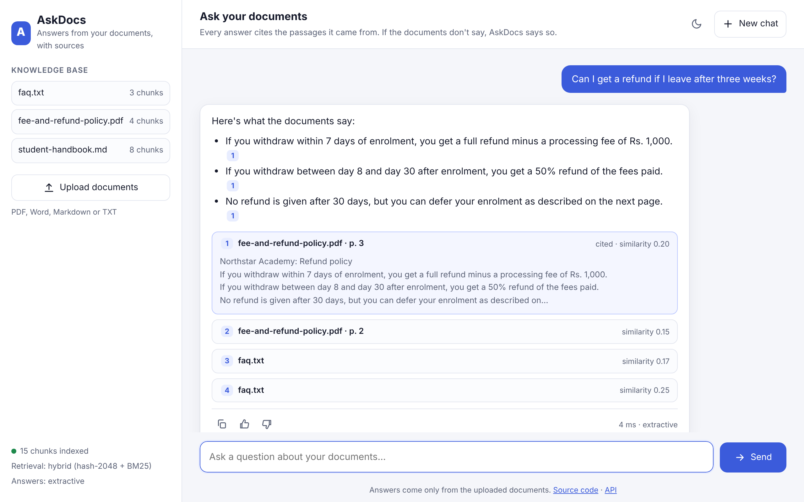
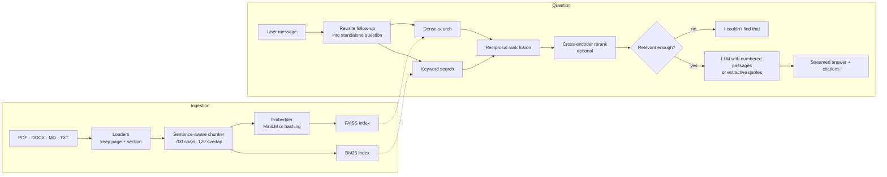

# AskDocs

[](https://github.com/24f2006816/askdocs/actions/workflows/ci.yml)


**Chat with your documents and get answers you can verify.** AskDocs is a retrieval-augmented generation (RAG) chatbot. Upload PDFs, Word files, Markdown or text and ask questions in plain language. Every answer streams in with citations to the exact file, page or section it came from, and when the documents don't contain the answer, AskDocs says so instead of guessing.



## Highlights

- **Hybrid retrieval:** dense embeddings (FAISS) plus BM25 keyword search, merged with reciprocal rank fusion, with optional cross-encoder reranking.
- **Verifiable answers:** `[1]`, `[2]` citations link to the source passage, its file, page and section. Click a citation to open the passage.
- **Refuses when unsure:** a calibrated relevance gate before generation, and a `NOT_FOUND` guard during generation that is caught before it reaches the user, even while streaming.
- **Streaming:** answers arrive token by token over server-sent events, from Gemini or OpenAI.
- **Conversations:** follow-ups such as "And for the crash course?" are rewritten into standalone questions before searching.
- **Works without keys or GPUs:** with no LLM key it quotes the best-matching sentences; with no embedding model it falls back to a lexical embedder.
- **Ready for a public demo:** admin-only uploads, per-client rate limiting, upload validation, request IDs and security headers.
- **Measured:** an evaluation script reports hit@k, MRR and refusal accuracy on a labelled question set, and CI runs it on every push.
- **Polished UI:** dark mode, mobile layout, copy button and thumbs up/down feedback, logged for review. No build step and no CDN.

## Architecture



## Quick start

```bash
git clone https://github.com/24f2006816/askdocs && cd askdocs
pip install -r requirements-dev.txt            # core + tests
pip install -r requirements-embeddings.txt     # optional: semantic search and reranking (PyTorch)
cp .env.example .env                           # optional: add GEMINI_API_KEY or OPENAI_API_KEY
uvicorn app.api:app --reload                   # open http://localhost:8000
```

Try these:

- "Can I get a refund if I leave after three weeks?" then "And for the crash course?"
- "When are the doubt-clearing sessions?"
- "Can I pay the fee in instalments?"
- "Who won the cricket world cup?" (it should refuse)

The sample documents describe **Northstar Academy, a fictional coaching institute**. Replace the files in `data/docs/` or use the Upload button to chat with your own.

## Evaluation

`python -m scripts.evaluate --sweep` runs 30 labelled questions (each tagged with the file and page or section that answers it) and 6 out-of-scope questions.

Measured in this repository with the offline hashing embedder (`EMBEDDER=hash`) on 15 chunks:

| Retrieval | Hit@1 | Hit@3 | Hit@5 | MRR |
| --- | --- | --- | --- | --- |
| Dense only (hashing) | 57% | 83% | 97% | 0.715 |
| BM25 only | 83% | 93% | 97% | 0.892 |
| **Hybrid (RRF)** | 67% | **97%** | **100%** | 0.812 |

- Out-of-scope questions refused: 83% (5 of 6).
- In-scope questions wrongly refused: 3% (1 of 30).
- Average search time: 0.1 ms per query.

Hybrid retrieval puts the right passage in the top 3 for 97% of questions, and the top 4 passages are what the LLM reads. The hashing embedder is a lexical lower bound. With `requirements-embeddings.txt` installed, the script also scores MiniLM embeddings and, when `RERANKER_MODEL` is set, a `hybrid+rerank` row. `--sweep` prints the refusal trade-off across thresholds, so `MIN_SIMILARITY` and `MIN_KEYWORD_COVERAGE` can be calibrated for any embedder.

## How it works

**Chunking.** Text is split into sentences and list items, then packed greedily into chunks of up to 700 characters. The last 120 characters of each chunk are repeated at the start of the next, so facts that straddle a boundary stay retrievable. PDF line wraps are re-joined, titles are kept separate, and abbreviations such as "Rs." do not end a sentence. Markdown and Word chunks remember their heading; PDF chunks remember their page; Word tables become rows.

**Hybrid retrieval.** Dense vectors catch paraphrases ("money back" finds "refund"). BM25 catches exact terms such as batch codes and numbers that embeddings blur. The two rankings are merged with reciprocal rank fusion, `score(d) = Σ 1 / (60 + rank(d))`, which needs no calibration between their very different score scales.

**Reranking.** With `RERANKER_MODEL` set, the top 20 fused candidates are re-scored by a cross-encoder, which reads the question and passage together and ranks far more precisely than either first-stage method. The Docker image enables `cross-encoder/ms-marco-MiniLM-L-6-v2` by default.

**Grounding.** A question is answered only if the best passage has cosine similarity of at least `MIN_SIMILARITY`, or at least `MIN_KEYWORD_COVERAGE` of the question's keywords appear in a retrieved passage. The LLM must cite every fact and reply `NOT_FOUND` when the passages don't contain the answer. While streaming, the first characters are held back until it is clear the reply is not `NOT_FOUND`, so the raw marker never reaches the user.

**Resilience.** If the LLM fails before answering, the user gets an extractive answer instead of an error. If it fails mid-answer, the partial answer is kept with a note. Gemini and OpenAI are called over plain HTTPS with `httpx`, behind a two-method interface (`generate`, `stream`).

## API

| Method | Path | Purpose |
| --- | --- | --- |
| GET | `/api/health` | Status, index size, models, usage stats (questions, refusal rate, latency) |
| GET | `/api/documents` | Indexed documents with chunk counts |
| POST | `/api/documents` | Upload files (multipart `files`); the index rebuilds. Admin token if configured |
| DELETE | `/api/documents/{name}` | Remove a document; the index rebuilds. Admin token if configured |
| POST | `/api/chat` | `{"message", "session_id"?}` returns the answer, citations and session id |
| POST | `/api/chat/stream` | Same input; server-sent events `meta` → `token`… → `done` |
| DELETE | `/api/chat/{session_id}` | Clear a conversation |
| POST | `/api/feedback` | `{"session_id", "question", "answer", "rating": "up" \| "down", "comment"?}` |

Interactive API docs are served at `/docs`.

```bash
curl -N localhost:8000/api/chat/stream -H 'Content-Type: application/json' \
  -d '{"message": "Can I pay the fee in instalments?"}'
```

## Configuration

All settings come from environment variables or `.env`; see [`.env.example`](.env.example).

| Variable | Default | Meaning |
| --- | --- | --- |
| `LLM_PROVIDER` | `auto` | `auto`, `gemini`, `openai` or `extractive` |
| `GEMINI_API_KEY` / `GEMINI_MODEL` | none / `gemini-3.6-flash` | Gemini settings |
| `OPENAI_API_KEY` / `OPENAI_MODEL` | none / `gpt-6-luna` | OpenAI settings |
| `EMBEDDER` | `auto` | `sentence-transformers`, `hash`, or `auto` (falls back to `hash`) |
| `EMBEDDING_MODEL` | `sentence-transformers/all-MiniLM-L6-v2` | Any sentence-transformers model |
| `RERANKER_MODEL` / `RERANK_CANDIDATES` | off / 20 | Cross-encoder for second-stage ranking |
| `CHUNK_SIZE` / `CHUNK_OVERLAP` / `TOP_K` | 700 / 120 / 4 | Chunking and passages sent to the LLM |
| `MIN_SIMILARITY` / `MIN_KEYWORD_COVERAGE` | 0.30 / 0.30 | Refusal thresholds |
| `ADMIN_TOKEN` | none | Required for uploads and deletes when set |
| `RATE_LIMIT_PER_MINUTE` | 30 | Chat and feedback requests per client (0 = unlimited) |

Model names change often. If a default model is retired, set `GEMINI_MODEL` or `OPENAI_MODEL` to a current one.

## Deploy

**Docker**

```bash
docker compose up --build    # http://localhost:8000
```

The image installs CPU-only PyTorch, downloads the embedding and reranker models, and builds the index at build time. Uploaded documents persist in `./data/docs`.

**Hugging Face Spaces (free), deployed automatically from GitHub**

1. Create a Hugging Face access token with write permission.
2. In this GitHub repository, open Settings, then Secrets and variables, then Actions, and add the secret `HF_TOKEN`. Optionally add `GEMINI_API_KEY` for fluent answers and `ADMIN_TOKEN` to lock uploads.
3. Push to `main`. After the tests pass, CI creates or updates the Space `<your-hf-username>/askdocs` and copies the optional secrets into it.

Set the repository variable `HF_SPACE` to deploy under a different name. You can also deploy from your machine with `HF_TOKEN=... make deploy`.

## Security

- Uploads accept only PDF, DOCX, Markdown and TXT, up to `MAX_UPLOAD_MB`; filenames are sanitised against path traversal.
- With `ADMIN_TOKEN` set, only token holders can add or delete documents; the token is compared in constant time.
- Chat and feedback are rate-limited per client IP.
- The UI escapes all model output before applying a small Markdown subset, so answers cannot inject HTML.
- API keys are read from the environment and never logged or sent to the browser.

## Tests

```bash
make check    # ruff lint + 43 tests
```

The tests cover chunking, Word and PDF loading, BM25, fusion, reranking, index staleness, streaming order, the `NOT_FOUND` hold-back, failure fallbacks, provider request formats, auth, rate limits, uploads and feedback. LLM calls run against scripted fakes and mocked HTTP, so the suite needs no API key and no network.

## Project structure

```
app/
  api.py          FastAPI routes, streaming, uploads, feedback, middleware
  chat.py         memory, query rewriting, grounding, streaming answers, citations
  config.py       settings from environment variables
  embeddings.py   sentence-transformers and hashing embedders
  index.py        BM25, FAISS search, reciprocal rank fusion, index persistence
  ingest.py       PDF / Word / Markdown / text loaders and the chunker
  llm.py          Gemini and OpenAI over HTTPS, with streaming
  rerank.py       optional cross-encoder reranking
  security.py     admin token and rate limiter
  service.py      builds the index and engine
  static/         single-page chat UI
scripts/          build_index, evaluate, deploy_hf_space, make_sample_pdf
data/docs/        sample documents (fictional institute)
data/eval/        labelled evaluation questions
tests/            pytest suite
```

## Roadmap

- Persist conversations in Redis so several workers can share them.
- OCR (for example Tesseract) for scanned PDFs.
- Per-user document collections.
- Answer-quality evaluation with an LLM judge, alongside the retrieval metrics.

## License

MIT © 2026 Pratyaksh Pandey
